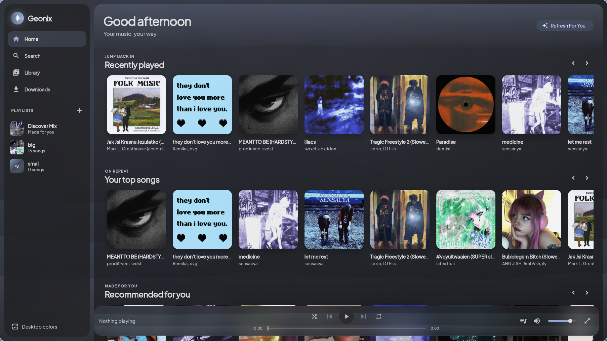
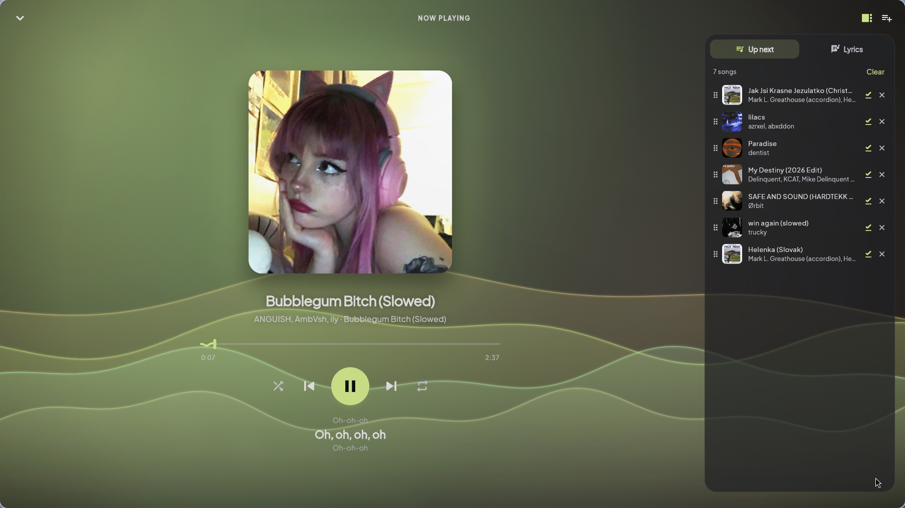
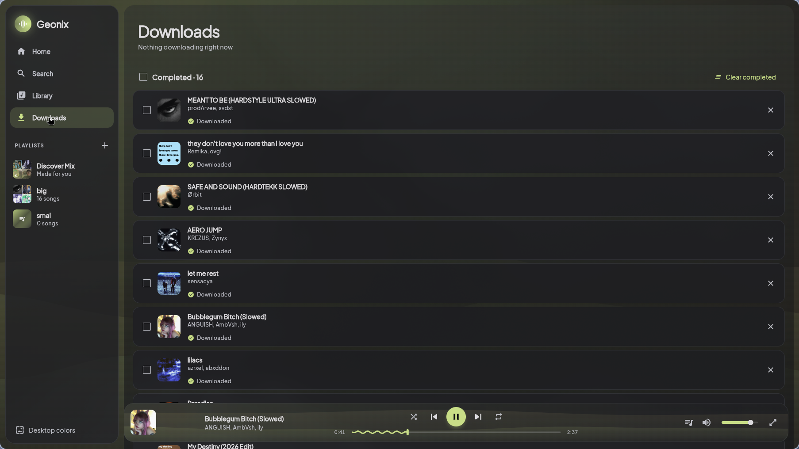

# Geonix Music Player

> [!IMPORTANT]
> **This project was made by AI, not written by me.**
> All of the code (the Rust backend, the Python worker, the Flutter app, the tests
> and this README) was generated by **Claude** (Anthropic's AI model, Opus 5.5)
> running in Claude Code. My part was the idea, the feature requests, testing it
> and giving feedback. It started as a test to compare AI coding models on the
> same prompt.



| Now Playing (synced lyrics + Up next) | Downloads |
|---|---|
|  |  |

> [!NOTE]
> For personal use only. The app downloads audio from YouTube / YouTube Music with
> yt-dlp; respect YouTube's Terms of Service and copyright law in your country, and
> only download music you have the right to.

A desktop music player for Linux in the spirit of YouTube Music and Spotify.
Search YouTube Music, download songs or whole playlists as tagged MP3s, build
playlists, play everything locally, and get a "For You" feed plus a daily
Discover Mix based on what you actually listen to.

| Part | Tech | Job |
|---|---|---|
| `app/` | Flutter (Dart 3, Linux desktop), Riverpod 3, media_kit | All screens and audio playback |
| `backend/` | Rust: axum 0.7, tokio, rusqlite (bundled SQLite), tower-http | HTTP API on `127.0.0.1:7878`, library database, download queue, audio streaming |
| `worker/` | Python 3.11+: yt-dlp, ytmusicapi, mutagen | YouTube Music search, downloads, ID3 tagging, recommendations |

## How the parts talk

```
Flutter app ──HTTP/JSON──▶ Rust backend (127.0.0.1:7878) ──JSON lines over stdin/stdout──▶ Python worker
     ▲                              │
     └── audio + covers (HTTP) ─────┘   SQLite: ~/.local/share/geonix/library.db
         progress (Server-Sent Events)  Music:  ~/Music/Geonix/<Artist>/<Album>/<Title>.mp3
```

- **The app talks only to the backend.** Even previews of songs you haven't
  downloaded are streamed through the backend, which proxies YouTube's audio
  with HTTP Range support, and cover art is served and cached by the backend too.
- **The backend starts the worker** as a child process and sends it one JSON
  object per line. Every request has an `id`; progress events and the final
  `result` or `error` carry the same `id`. If the worker crashes, the backend
  restarts it, with backoff, and fails the requests that were in flight.
- **The worker** runs commands in a thread pool, so a download never blocks a
  search. Its real stdout is reserved for the protocol: file descriptor 1 is
  redirected to stderr, so stray prints from libraries or ffmpeg can't corrupt
  a message. All logs go to stderr.

### Worker protocol

Backend → worker:
```json
{"id": "uuid", "cmd": "search", "query": "daft punk", "limit": 20}
{"id": "uuid", "cmd": "playlist_info", "url": "https://music.youtube.com/playlist?list=..."}
{"id": "uuid", "cmd": "download", "video_id": "abc123", "dest_dir": "/home/you/Music/Geonix", "covers_dir": "...", "meta": {...}}
{"id": "uuid", "cmd": "recommend", "seed_video_ids": ["a","b"], "exclude_video_ids": ["..."], "limit": 30}
{"id": "uuid", "cmd": "stream_url", "video_id": "abc123"}
```
Worker → backend:
```json
{"id": "uuid", "type": "progress", "percent": 42.5, "speed": "1.2MiB/s"}
{"id": "uuid", "type": "result", "data": { ... }}
{"id": "uuid", "type": "error", "message": "Video unavailable"}
```
Every track uses one shape everywhere (worker results and API):
```json
{"video_id": "abc123", "title": "One More Time", "artist": "Daft Punk", "album": "Discovery",
 "duration_sec": 320, "thumbnail_url": "https://...", "file_path": null, "downloaded": false}
```
Library songs also carry `play_count`, `last_played` and `added_at` (Unix ms).

## Install (Arch Linux / CachyOS)

```bash
# Build tools, Python, ffmpeg (for MP3 conversion), libmpv (for playback), GTK
sudo pacman -S --needed base-devel rustup python ffmpeg mpv gtk3 clang cmake ninja pkgconf curl
rustup default stable

# Flutter: from the AUR (or follow https://docs.flutter.dev/get-started/install/linux)
yay -S flutter-bin
flutter config --enable-linux-desktop
flutter doctor        # the "Linux toolchain" line should be green
```

## Run

```bash
./run.sh
```

`run.sh` creates the worker venv (`worker/.venv`), builds the backend and the
app in release mode, starts the backend, waits for `/api/health` and opens the
app. Closing the app stops the backend and its worker.

### Run the parts by hand (development)

```bash
# 1. Worker dependencies (once)
python3 -m venv worker/.venv && worker/.venv/bin/pip install -r worker/requirements.txt

# 2. Backend (starts the worker itself)
cd backend && cargo run

# 3. App, in another terminal
cd app && flutter run -d linux
```

### Configuration (environment variables)

| Variable | Default | Meaning |
|---|---|---|
| `GEONIX_PORT` | `7878` | Backend port (pass the same port to the app with `--dart-define=GEONIX_API=http://127.0.0.1:<port>`; `run.sh` does this for you) |
| `GEONIX_DATA_DIR` | `~/.local/share/geonix` | Database and cover cache |
| `GEONIX_MUSIC_DIR` | `~/Music/Geonix` | Where MP3s are saved |
| `GEONIX_PYTHON` | `worker/.venv/bin/python`, else `python3` | Python used for the worker |
| `GEONIX_WORKER` | `worker/worker.py` | Worker script |
| `RUST_LOG` | `info` | Backend log level |
| `GEONIX_WORKER_LOG` | `INFO` | Worker log level |

## Tests

```bash
cd backend && cargo test && cargo clippy --all-targets      # 13 tests: database, playlist ordering, worker protocol
cd worker  && .venv/bin/pip install -r requirements-dev.txt && .venv/bin/python -m pytest   # 23 tests, no network
cd app     && flutter analyze && flutter test               # widget tests + palette/format tests
```

## Features

- **Search** YouTube Music for songs only; videos, podcasts and user uploads are filtered out.
  Click a result to preview it, or use the download button.
- **Playlist import:** paste a YouTube or YouTube Music playlist link into
  Search to preview it, then "Download all". A local playlist with the same
  name and order appears immediately and fills up as songs finish downloading.
- **Download queue:** at most 3 downloads at once, with live progress and speed
  over Server-Sent Events. Failed downloads show the reason and a Retry
  button. Songs already in your library are skipped. Downloads that were
  running when the app quit are marked as failed on the next start, so you can retry them.
- **Tagged MP3s:** title, artist and album are written as ID3 tags, with embedded cover art.
- **Library:** Songs, Artists, Albums and Playlists views, an instant text
  filter, and sorting by date added, title, artist, album, most played or
  recently played. Play counts and the last-played time are tracked.
- **Playlists:** create, rename, delete, add or remove songs, and reorder by
  drag and drop. Covers are a 2×2 mosaic of the first four songs. Deleting a
  playlist never deletes files.
- **Player:** play/pause, next, previous, seek, volume, shuffle, and repeat
  (off/all/one). The "Up next" queue can be reordered, edited and jumped
  through. A glass player bar is always visible, and a full-screen Now Playing
  view has a gradient taken from the cover's colors.
- **For You:** the Home screen has Recently played, Your top songs,
  Recommended for you and "Because you listened to …". The Discover Mix is
  rebuilt with a button and automatically once a day; preview or download its
  songs one by one or all at once.
- **Look:** dark theme by default plus a light theme. The accent color is
  taken from the playing song's cover and fades smoothly. Hover animations,
  page transitions, a morphing play button, loading skeletons and friendly
  empty states. Plus Jakarta Sans font. The window's minimum size is 1000×650.
- **Keyboard:** Space toggles play/pause, Ctrl+→ and Ctrl+← skip to the
  next or previous song, Ctrl+F opens Search. Shortcuts are ignored while you
  type in a text field.

### How recommendations work

The worker takes up to 10 seed songs: your 5 most played and your 5 most
recently added. For each seed it asks YouTube Music for its radio (the songs
it would play next). Songs found through several seeds score highest, and an
earlier position in a seed's list breaks ties. Songs already in your library
are removed, and no artist may fill more than 4 spots. Each recommendation
remembers which seed found it, which powers "Because you listened to …".

## REST API

All errors return `{"error": "message"}` with a 400, 404, 500 or 503 status.
CORS allows `localhost` and `127.0.0.1` origins.

| Method | Path | Description |
|---|---|---|
| GET | `/api/health` | `{"status":"ok","worker":"running"}` |
| GET | `/api/search?q=&limit=` | Search YouTube Music (songs only) |
| GET | `/api/tracks?sort=&q=` | Library songs. `sort`: `added` (default), `title`, `artist`, `album`, `plays`, `recent`, `duration` |
| GET | `/api/tracks/{id}` | One song |
| GET | `/api/tracks/{id}/stream` | Audio with `Range` support (local file, or a proxied preview) |
| GET | `/api/tracks/{id}/cover` | Cover image (embedded cover or cached thumbnail) |
| POST | `/api/tracks/{id}/played` | Increase the play count |
| DELETE | `/api/tracks/{id}?delete_file=true` | Remove from the library (and optionally delete the file) |
| GET | `/api/artists` · `/api/albums` | Grouped views |
| GET / POST | `/api/playlists` | List / create `{"name": "..."}` |
| GET / PATCH / DELETE | `/api/playlists/{id}` | Get with tracks / rename `{"name"}` / delete |
| POST | `/api/playlists/{id}/tracks` | Add `{"track_id": "..."}` |
| DELETE | `/api/playlists/{id}/tracks/{track_id}` | Remove |
| PUT | `/api/playlists/{id}/order` | `{"track_ids": [...]}`, the full new order |
| POST | `/api/downloads` | `{"video_id": "..."}` or `{"playlist_url": "..."}` |
| GET | `/api/downloads` | Queue with status and progress |
| POST | `/api/downloads/{id}/retry` | Retry a failed download |
| GET | `/api/downloads/events` | Server-Sent Events: `download` events carry the download JSON; `resync` means re-fetch the list |
| GET | `/api/recommendations?limit=` | "For You" list |
| POST | `/api/recommendations/refresh` | Rebuild recommendations and the Discover Mix |
| GET | `/api/playlist-info?url=` | *(extra)* Preview a playlist before importing it |

## Project layout

```
geonix_music_player/
├── run.sh                    build + start everything
├── backend/                  Rust
│   └── src/
│       ├── main.rs           startup, config, shutdown
│       ├── db.rs             SQLite schema, migrations, queries (+ tests)
│       ├── worker.rs         spawns and supervises the Python worker (+ tests)
│       ├── downloads.rs      queue (3 parallel), SSE broadcast, playlist import
│       ├── models.rs         shared structs
│       ├── error.rs          JSON errors
│       └── routes/           mod (router, health, search), tracks, playlists, downloads, recommendations
├── worker/                   Python
│   ├── worker.py             protocol loop
│   ├── ytm.py                search, playlist info, related songs, stream URLs
│   ├── downloader.py         yt-dlp + mutagen tagging
│   ├── recommender.py        taste profile + ranking
│   └── tests/                pytest (no network)
└── app/                      Flutter
    └── lib/
        ├── main.dart, theme.dart
        ├── api/client.dart   HTTP + SSE client
        ├── models/           Track, Playlist, Download, Artist/Album
        ├── state/            Riverpod providers, player controller, cover palette, actions
        ├── screens/          shell, home, search, library, playlist, downloads, now playing, artist/album
        └── widgets/          player bar, controls, seek bar, sidebar, queue, track tile, cards, skeletons…
```

## Troubleshooting

- **"Can't reach the Geonix backend":** start it with `./run.sh` or `cd backend && cargo run`.
- **`/api/health` says `"worker":"stopped"`:** the worker venv is missing.
  Run `python3 -m venv worker/.venv && worker/.venv/bin/pip install -r worker/requirements.txt`.
- **Downloads fail with "Conversion to MP3 failed":** install `ffmpeg`.
- **No sound:** media_kit needs `libmpv` (`sudo pacman -S mpv`).
- **YouTube changed something:** update yt-dlp with `worker/.venv/bin/pip install -U yt-dlp`.

Only download music you have the right to download.
